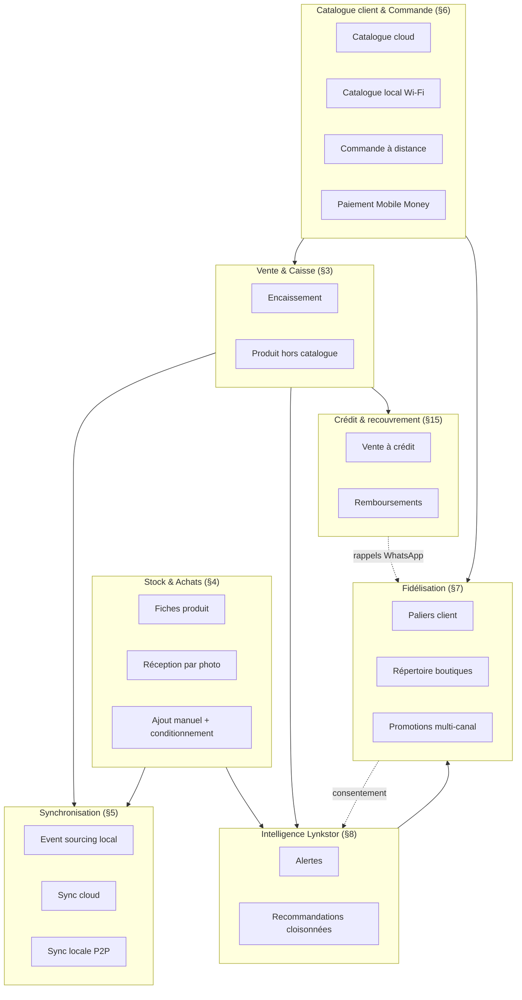
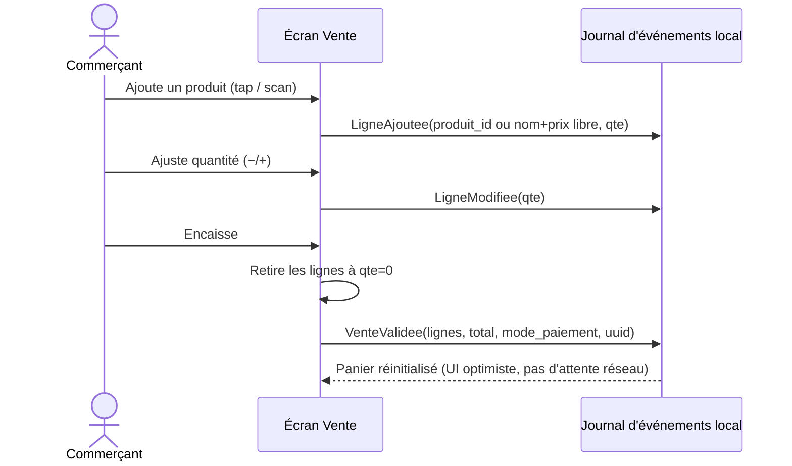
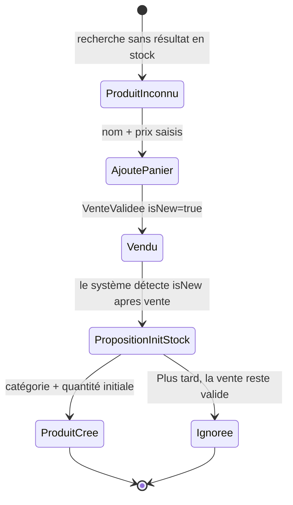

# Lynkstor — Architecture fonctionnelle détaillée
### Spécification pour équipe de développement et agents IA de développement

---

## 0. Comment lire ce document

Ce document décrit **ce que le système doit faire et comment ses parties communiquent**, domaine fonctionnel par domaine fonctionnel — pas le schéma de base de données définitif, ni le choix d'infrastructure (voir `Lynkstor_Architecture_Technique.md` pour cela), ni les écrans (voir `Lynkstor_UIUX_MVP_v2.md`).

Chaque domaine suit la même structure : **objectif → acteurs → règles → diagramme → cas limites → dépendances**. Un agent IA de développement qui implémente une fonctionnalité doit pouvoir répondre, avant d'écrire du code : *quel événement est produit, par qui, dans quel état, et qui a le droit de le lire ?*

---

## 1. Glossaire commun (terminologie à respecter dans le code)

| Terme | Définition | Ne pas confondre avec |
|---|---|---|
| **Tenant** | Un commerce Lynkstor, avec ses propres données isolées | "Boutique" (terme produit équivalent, usage interchangeable en documentation) |
| **Événement** | Fait immuable horodaté (vente, mouvement de stock…), unité de base de la synchronisation | Une "transaction" au sens SQL |
| **Commande client** | Panier constitué par un client via le catalogue QR, pas encore une vente | Une "vente" (§3) |
| **Vente** | Transaction encaissée, confirmée, tracée dans le registre financier | Une commande client encore *nouvelle* ou *vue* |
| **Produit hors catalogue** | Article vendu sans fiche stock préexistante | Un produit en rupture (qui, lui, a une fiche) |
| **Client** (au sens fidélisation) | Une identité fédérée au niveau plateforme (`client_id`) | Un `client_boutique_link`, qui est la relation *avec une boutique précise* |
| **Palier client** | Anonyme → Reconnu → Installé → Identifié (§7.1) | Un "statut de compte" — il n'y a jamais de compte à créer |
| **Conditionnement** | Unité de vente d'un produit (unité, carton, paquet) | La catégorie du produit |

---

## 2. Cartographie des domaines fonctionnels

**Règle de lecture transversale** : une flèche qui traverse une frontière de domaine doit toujours pouvoir se justifier par un événement ou une donnée précise nommée dans ce document — jamais par un accès direct "parce que c'est plus simple".

---

## 3. Domaine : Vente & Caisse

### 3.1 Objectif
Permettre l'encaissement le plus rapide possible, y compris pour un produit sans fiche existante, sans jamais bloquer la transaction pour une raison de gestion.

### 3.2 Règles fonctionnelles
- Une vente est composée de lignes ; chaque ligne référence un produit **ou** un couple `(nom, prix)` libre si le produit est inconnu (`isNew = true`).
- Une ligne à quantité 0 au moment de l'encaissement est retirée avant la création de l'événement de vente — jamais persistée à zéro.
- Une vente encaissée est **irréversible** : toute correction se fait par un événement d'annulation/ajustement distinct, jamais par modification de l'événement d'origine (cohérent avec §5.1).

### 3.3 Séquence — vente simple

### 3.4 Cas limite — produit hors catalogue

**Règle clé** : la proposition d'initialiser le stock n'apparaît **qu'après** `VenteValidee` — jamais avant, jamais comme condition à l'encaissement.

---

## 4. Domaine : Stock & Achats

### 4.1 Objectif
Maintenir une fiche produit à jour avec un minimum de saisie, quelle que soit la source (achat scanné, ajout manuel, ou régularisation post-vente).

### 4.2 Entités fonctionnelles
- **Produit** : `id, nom, catégorie, prix, quantité, conditionnement?, tenant_id`
- **Conditionnement** (optionnel) : `type (unité | carton | paquet), taille`
- **Catégorie** : issue du profil sectoriel du tenant (préremplie), éditable

### 4.3 Mouvements Additifs
Tout changement de quantité (vente, réception, ajustement manuel +/−) est un **événement additif**, jamais une écriture d'état absolu.

---

## 5. Domaine : Synchronisation & continuité hors-ligne

### 5.1 Principe — event sourcing local
Toute action métier est un événement immuable : `{uuid, tenant_id, type, payload, horodatage_local, appareil_id, statut_sync}`. Aucune table d'état n'est éditée directement ; les vues affichées sont des **projections calculées**.

### 5.2 Règles de fusion
- **Mouvement de stock** : Additif.
- **Vente** : Dédupliquée uniquement par `uuid`.
- **Fiche produit** : Dernière écriture gagnante (LWW).

---

## 6. Domaine : Catalogue client & Commande à distance (QR)

- Support du **catalogue cloud** et du **catalogue local Wi-Fi** (isoler du maillage sync interne).
- Support des paiements Mobile Money (Push USSD) sans stockage du PIN.

---

## 9. Domaine : Groupe & multi-boutique

- Chaque boutique est un **tenant autonome**.
- Rôle attribué au **Personnel** (réaffectable via événement `PersonnelReaffecte`), pas figé à l'appareil.
- Vue consolidée en lecture seule pour le **Propriétaire**.

---

## 15. Domaine : Crédit & recouvrement ("carnet de dette")

- Reste **strictly local au tenant**.
- Mouvements additifs (`MouvementCredit` : `vente_a_credit` | `remboursement`).
- Solde calculé dynamiquement (`SUM(MouvementCredit)`).

---

## 13. Règles transversales non négociables

1. **Une vente ou un mouvement de stock ne peut jamais être bloqué**.
2. **Tout événement métier est immuable et identifié par UUID**.
3. **Aucune requête ne doit pouvoir traverser deux tenants** (isolation absolue par `tenant_id`).
4. **Le mode hors ligne est le mode par défaut**.
5. **Le consentement est explicite, jamais pré-coché**.
