# DAVEX Business Suite™ — Architecture fonctionnelle détaillée
### Spécification pour équipe de développement et agents IA de développement

---

## 0. Comment lire ce document

Ce document décrit **ce que le système doit faire et comment ses parties communiquent**, domaine fonctionnel par domaine fonctionnel — pas le schéma de base de données définitif, ni le choix d'infrastructure (voir `DAVEX_Architecture_Technique.md` pour cela), ni les écrans (voir `DAVEX_UIUX_MVP_v2.md`).

Chaque domaine suit la même structure : **objectif → acteurs → règles → diagramme → cas limites → dépendances**. Un agent IA de développement qui implémente une fonctionnalité doit pouvoir répondre, avant d'écrire du code : *quel événement est produit, par qui, dans quel état, et qui a le droit de le lire ?*

---

## 1. Glossaire commun (terminologie à respecter dans le code)

| Terme | Définition | Ne pas confondre avec |
|---|---|---|
| **Tenant** | Un commerce DAVEX, avec ses propres données isolées | "Boutique" (terme produit équivalent, usage interchangeable en documentation) |
| **Événement** | Fait immuable horodaté (vente, mouvement de stock…), unité de base de la synchronisation | Une "transaction" au sens SQL |
| **Commande client** | Panier constitué par un client via le catalogue QR, pas encore une vente | Une "vente" (§3) |
| **Vente** | Transaction encaissée, confirmée, tracée dans le registre financier | Une commande client encore *nouvelle* ou *vue* |
| **Produit hors catalogue** | Article vendu sans fiche stock préexistante | Un produit en rupture (qui, lui, a une fiche) |
| **Client** (au sens fidélisation) | Une identité fédérée au niveau plateforme (`client_id`) | Un `client_boutique_link`, qui est la relation *avec une boutique précise* |
| **Palier client** | Anonyme → Reconnu → Installé → Identifié (§7.1) | Un "statut de compte" — il n'y a jamais de compte à créer |
| **Conditionnement** | Unité de vente d'un produit (unité, carton, paquet) | La catégorie du produit |

---

## 2. Cartographie des domaines fonctionnels

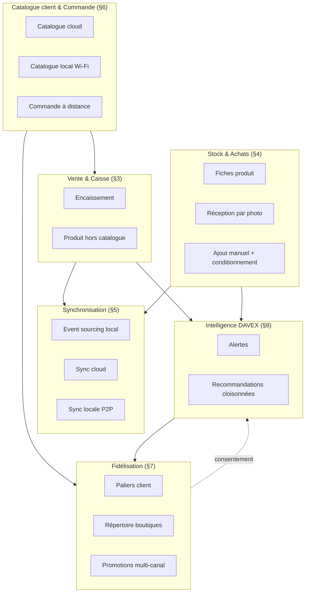

**Règle de lecture transversale** : une flèche qui traverse une frontière de domaine doit toujours pouvoir se justifier par un événement ou une donnée précise nommée dans ce document — jamais par un accès direct "parce que c'est plus simple".

---

## 3. Domaine : Vente & Caisse

### 3.1 Objectif
Permettre l'encaissement le plus rapide possible, y compris pour un produit sans fiche existante, sans jamais bloquer la transaction pour une raison de gestion.

### 3.2 Règles fonctionnelles
- Une vente est composée de lignes ; chaque ligne référence un produit **ou** un couple `(nom, prix)` libre si le produit est inconnu (`isNew = true`).
- Une ligne à quantité 0 au moment de l'encaissement est retirée avant la création de l'événement de vente — jamais persistée à zéro.
- Une vente encaissée est **irréversible** : toute correction se fait par un événement d'annulation/ajustement distinct, jamais par modification de l'événement d'origine (cohérent avec §5.1).

### 3.3 Séquence — vente simple

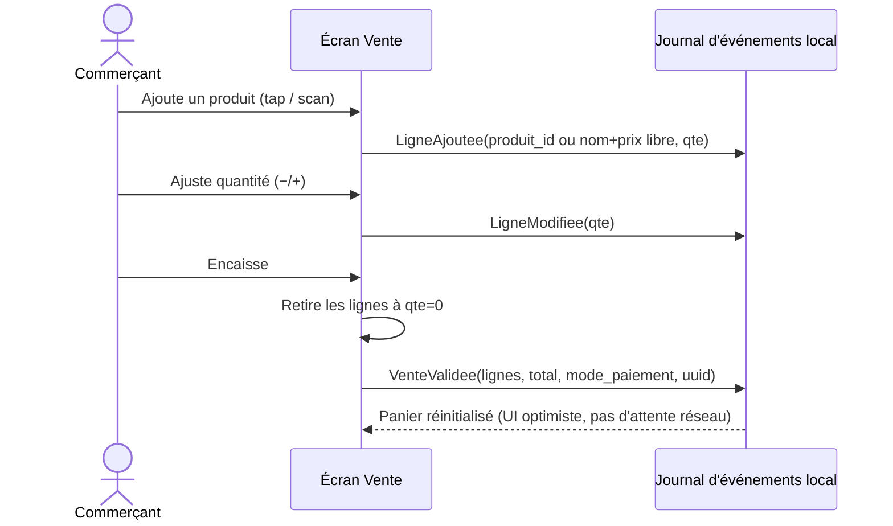

### 3.4 Cas limite — produit hors catalogue

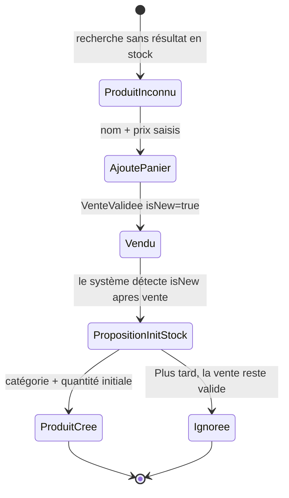

**Règle clé** : la proposition d'initialiser le stock n'apparaît **qu'après** `VenteValidee` — jamais avant, jamais comme condition à l'encaissement.

### 3.5 Dépendances
- Émet des événements consommés par §5 (synchronisation), §8 (IA — détection d'anomalies), §4 (création de fiche produit).
- Consomme les commandes client confirmées de §6 (une commande devient un panier de vente prérempli).

---

## 4. Domaine : Stock & Achats

### 4.1 Objectif
Maintenir une fiche produit à jour avec un minimum de saisie, quelle que soit la source (achat scanné, ajout manuel, ou régularisation post-vente).

### 4.2 Entités fonctionnelles
- **Produit** : `id, nom, catégorie, prix, quantité, conditionnement?, tenant_id`
- **Conditionnement** (optionnel) : `type (unité | carton | paquet), taille`
- **Catégorie** : issue du profil sectoriel du tenant (préremplie), éditable

### 4.3 Séquence — réception par photo de facture

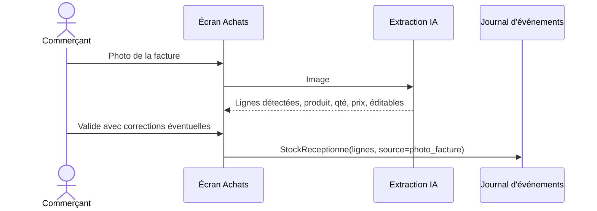

### 4.4 Séquence — ajout manuel avec conditionnement

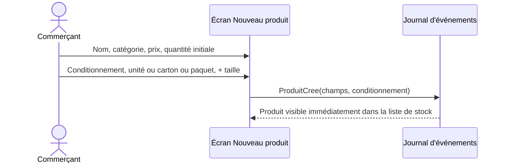

### 4.5 Règle transversale — mouvements additifs
Tout changement de quantité (vente, réception, ajustement manuel +/−) est un **événement additif**, jamais une écriture d'état absolu — condition nécessaire pour que la fusion en §5.2 (offline, multi-appareils) reste correcte sans coordination centrale.

### 4.6 Dépendances
- Reçoit des créations de produit déclenchées par §3.4 (vente hors catalogue).
- Alimente §8 (détection de rupture, marge en baisse) et §6 (catalogue client, toujours une projection en lecture du stock).

---

## 5. Domaine : Synchronisation & continuité hors-ligne

### 5.1 Principe — event sourcing local
Toute action métier est un événement immuable : `{uuid, tenant_id, type, payload, horodatage_local, appareil_id, statut_sync}`. Aucune table d'état n'est éditée directement ; les vues affichées (stock disponible, CA du jour) sont des **projections calculées** à partir du flux d'événements.

### 5.2 Règles de fusion (à respecter dans toute implémentation de la sync)

| Type d'événement | Règle de fusion |
|---|---|
| Mouvement de stock | Additif — deux événements concurrents s'appliquent tous les deux |
| Vente | Jamais fusionnée, jamais écrasée — les doublons se dédupliquent uniquement par `uuid` |
| Fiche produit (prix, nom) | Dernière écriture gagnante par horodatage serveur ; conflit journalisé, jamais résolu silencieusement si ambigu |
| Commande client | Machine à états dédiée (§6.4) — jamais un simple merge de champs |

### 5.3 Séquence — synchronisation cloud

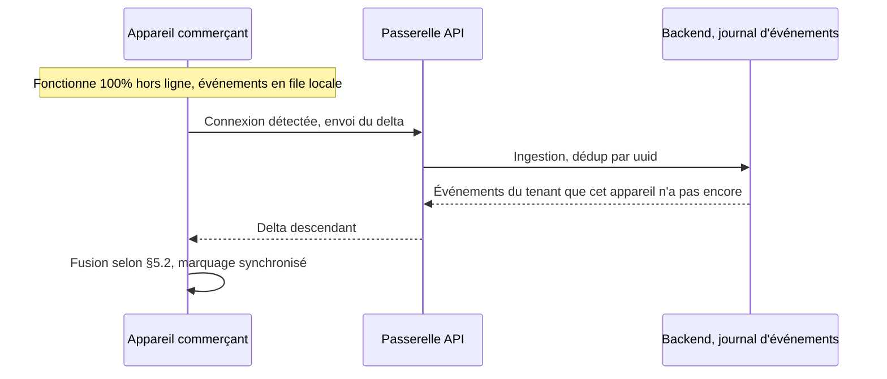

### 5.4 Séquence — synchronisation locale entre appareils (sans Internet)

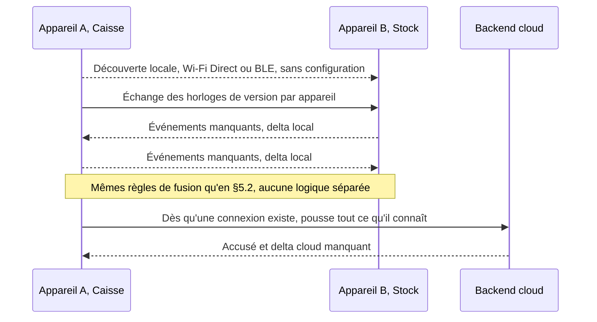

### 5.5 Cas limite — commerce sans Internet plusieurs jours
Le système doit rester intégralement fonctionnel pour la vente et le stock. Seules les capacités dépendant intrinsèquement du cloud (IA cross-tenant, catalogue métier partagé, fidélisation multi-boutiques) sont différées — jamais en erreur, toujours affichées comme "disponible à la reconnexion".

### 5.6 Dépendances
Domaine transversal — consommé par tous les autres (§3, §4, §6, §7 émettent tous des événements qui transitent par ce mécanisme).

---

## 6. Domaine : Catalogue client & Commande à distance (QR)

### 6.1 Objectif
Permettre à un client, sans compte ni installation, de composer un panier via un QR Code et de le transmettre instantanément à la caisse — que la boutique ait Internet ou non.

### 6.2 Entités fonctionnelles
- **CommandeClient** : `id, tenant_id, client_id?, nom, telephone?, lignes[], statut, canal, horodatage`
- **Canal** ∈ `{catalogue_cloud, catalogue_local}`
- **Mode** ∈ `{scan_achat, precommande}`

### 6.3 Séquence — catalogue, deux transports

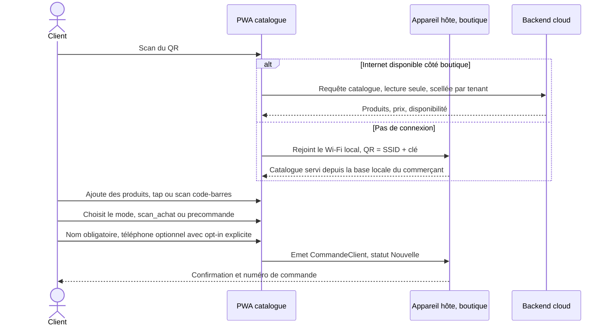

### 6.4 Machine à états — commande client

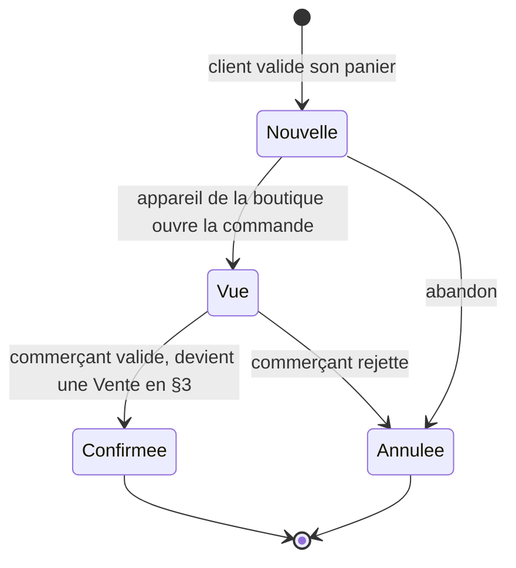

### 6.5 Règles de sécurité (non négociables)
- Le catalogue exposé publiquement ne contient **jamais** coût d'achat, marge, ni quantité exacte en stock — seulement prix de vente et disponibilité binaire.
- Limitation de débit par tenant et par IP, sur les deux transports.
- Le réseau Wi-Fi local du mode `catalogue_local` est isolé du maillage de synchronisation entre appareils du commerce (§5.4) — un client ne doit jamais avoir de visibilité sur ce trafic interne.

### 6.6 Dépendances
- Consomme le stock/catalogue de §4 en lecture seule.
- Alimente §3 (une commande confirmée devient une vente) et §7 (le numéro partagé devient la clé de rattachement du profil client).

### 6.7 Généralisation — la commande fournisseur réutilise ce mécanisme, elle n'en est pas un autre
Une commande passée par la boutique à un fournisseur (réception, préparation, livraison, facture) **n'est pas un nouveau domaine fonctionnel** : c'est la même machine à états qu'en §6.4, avec les rôles inversés.

| | Commande client | Commande fournisseur |
|---|---|---|
| Émetteur | Client final | Boutique |
| Destinataire | Boutique | Fournisseur |
| Nouvelle → Vue → Confirmée/Annulée | Identique | Identique |
| Ce qui suit `Confirmée` | Devient une Vente (§3) | Devient une réception de stock (§4.3), déclenchée par la photo de la facture du fournisseur |

**Conséquence pour l'implémentation** : l'entité `CommandeClient` (§6.2) doit être modélisée avec un champ `sens` (`entrant` = client→boutique, `sortant` = boutique→fournisseur) plutôt que dupliquée en une entité distincte `CommandeFournisseur`. Un seul module de commande, deux sens d'usage.

---

## 7. Domaine : Fidélisation client (DAVEX Client — PWA persistante)

### 7.1 Machine à états — paliers du client

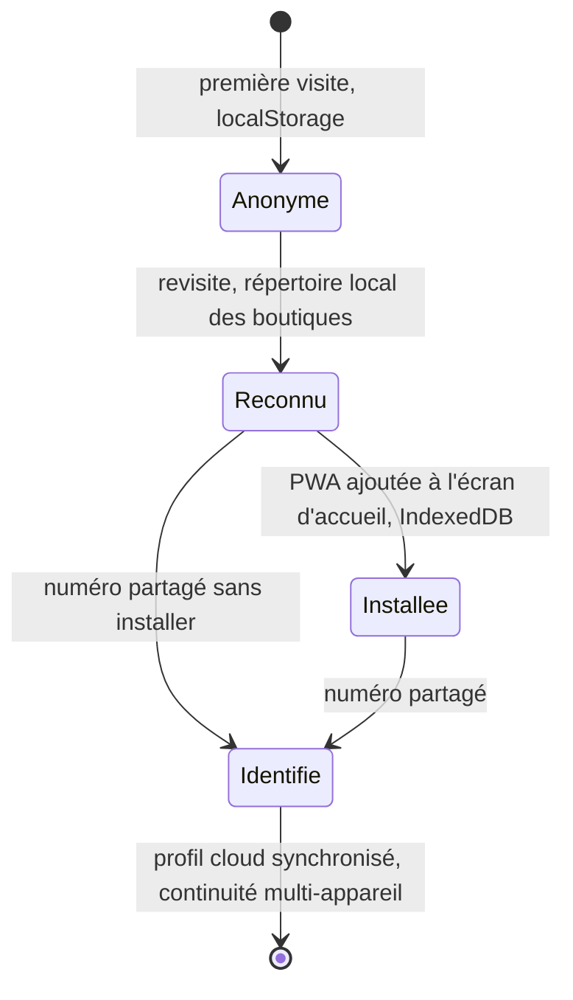

**Règle non négociable** : aucun palier n'est une condition pour commander (§6). Chaque palier ajoute de la continuité, jamais une fonctionnalité de base retirée aux paliers antérieurs.

### 7.2 Entités fonctionnelles
- **Client** : `client_id (plateforme), telephone?, statut_palier`
- **ClientBoutiqueLink** : `client_id, tenant_id, consentement (bool), premiere_visite, derniere_visite` — **jamais de jointure inter-tenant possible sur cette table**
- **Historique** côté client = projection en lecture de `EVENEMENT` / `COMMANDE_CLIENT` du tenant, filtrée par `client_id`, exposée uniquement si `ClientBoutiqueLink.consentement = true`

### 7.3 Séquence — diffusion d'une promotion, multi-canal

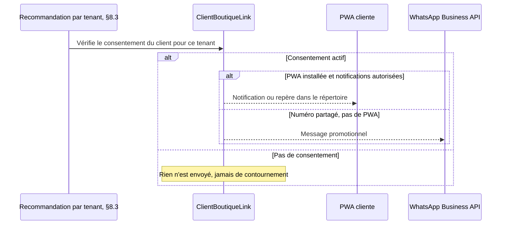

### 7.4 Règle d'isolation — à ne jamais violer dans le code
Le moteur de recommandation est **partagé en infrastructure, jamais en données** : une requête de recommandation pour le tenant A ne doit **structurellement** pas pouvoir accéder à l'historique d'achat du même client chez le tenant B. Ce n'est pas une règle de filtrage applicative à ajouter après coup — la requête elle-même doit être scellée par `tenant_id` dès sa construction.

### 7.5 Dépendances
- La clé de rattachement (`telephone`) vient de §6 (commande client).
- Consomme les événements de vente de §3 pour construire l'historique.
- Consomme les sorties de §8.3 (recommandations) en entrée du canal de diffusion.

---

## 8. Domaine : Intelligence DAVEX

### 8.1 Deux familles de traitement

| Famille | Où | Exemples |
|---|---|---|
| IA périphérique | Sur l'appareil, sans réseau | OCR facture, reconnaissance code-barres, extraction vocale |
| IA serveur | Backend, par tenant | Prédiction de rupture, marge en baisse, anomalies, recommandations |

### 8.2 Séquence — alerte de rupture

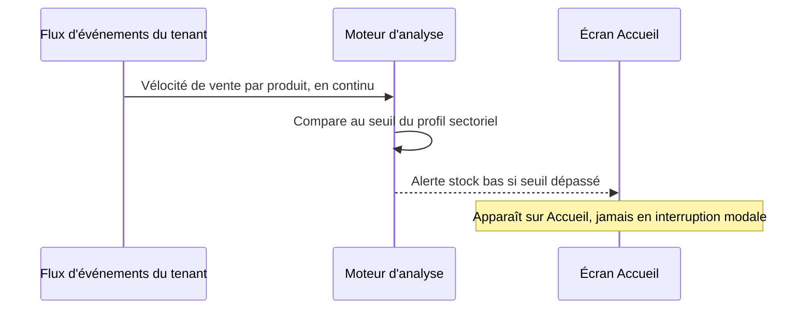

### 8.3 Recommandation cross-boutique — cloisonnement strict
Voir §7.4. Le service partage le code du moteur de scoring, jamais un espace de données commun entre tenants. Distinct de l'apprentissage du catalogue métier par secteur (§8.4), qui lui est volontairement agrégé et anonymisé.

### 8.4 Apprentissage du catalogue métier (agrégé, anonymisé, distinct de §8.3)
Chaque nouveau produit validé par un commerçant peut enrichir les suggestions par secteur pour l'ensemble des tenants — **au niveau du produit générique** (nom, catégorie), jamais au niveau du comportement d'achat d'un client ou d'un commerce identifiable.

### 8.5 Dépendances
Lit les événements de §3, §4 ; écrit vers §7 (recommandations) et vers l'UI Accueil (alertes).

### 8.6 Le client bénéficie de l'IA, jamais en direct
Le client ne dispose d'aucun canal conversationnel avec l'IA — il n'existe pas d'"Assistant IA" côté PWA. Le bénéfice est **toujours indirect** : recommandations et promotions livrées via §7.3, jamais une interface où le client interrogerait le moteur d'analyse. Si un assistant conversationnel côté client devait un jour exister, ce serait un nouveau domaine fonctionnel à spécifier séparément, pas une extension implicite de celui-ci.

---

## 9. Domaine : Groupe & multi-boutique

### 9.1 Objectif
Permettre à un même propriétaire d'exploiter **plusieurs boutiques autonomes**, distribuées dans une ville ou un pays, sans jamais fusionner leurs opérations quotidiennes — seulement leur vision d'ensemble.

### 9.2 Principe fondateur — l'autonomie d'abord
Chaque boutique reste un **tenant à part entière** : son propre stock, ses propres ventes, son propre maillage de synchronisation locale (§5.4, physiquement limité à sa portée Wi-Fi/BLE — deux boutiques dans deux villes ne peuvent structurellement pas se synchroniser en local entre elles). Le regroupement sous un même propriétaire est une couche de **consultation et de consolidation**, jamais une fusion des opérations.

### 9.3 Le personnel — géré par le propriétaire, pas figé à l'enregistrement d'un appareil
Correction par rapport à une première hypothèse : le rôle n'est **pas** figé de façon permanente à un appareil. Il appartient à une entité **Personnel**, que le propriétaire peut créer, réaffecter à une autre boutique, ou dont il peut modifier le rôle à tout moment — l'appareil (Point) n'est que le moyen d'accès que ce personnel utilise sur le moment.

- Un **Personnel** est rattaché à **une boutique à la fois** (`tenant_id`), avec un **rôle** (caisse, stock, supervision).
- Le **Propriétaire** peut réaffecter un personnel d'une boutique à une autre, ou changer son rôle, depuis une interface de gestion centrale.
- Un changement d'affectation ou de rôle est un événement administratif (`PersonnelReaffecte`) — il n'a pas besoin de fonctionner hors ligne comme les événements de vente (§5) : il transite par le cloud et s'applique à la prochaine connexion du personnel concerné.

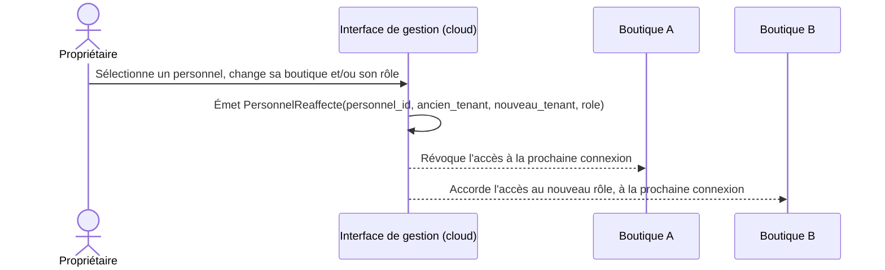

### 9.4 Entités fonctionnelles
- **Propriétaire** : `proprietaire_id, nom`
- **Boutique** = **Tenant** (§10) : `tenant_id, proprietaire_id (FK), secteur, ville, horaires (§9.9)`
- **Personnel** : `personnel_id, nom, tenant_id (FK, boutique actuelle), role (caisse | stock | supervision)`
- **Point** (appareil) : `point_id, personnel_id (FK), date_derniere_connexion` — un simple moyen d'accès, pas le porteur du rôle

### 9.5 Diagramme — un propriétaire, plusieurs boutiques autonomes

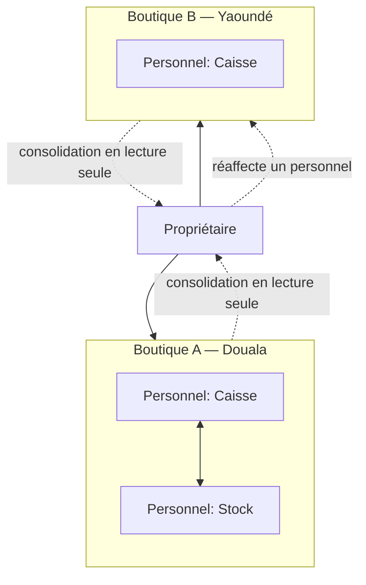

**Lecture du schéma** : la synchronisation locale (traits pleins entre personnels) ne relie que des personnes d'une même boutique. Ce que le propriétaire fait remonter (traits pointillés vers lui) est une consolidation en lecture seule ; ce qu'il peut faire descendre (réaffectation) est une action administrative explicite, jamais automatique.

### 9.6 Ce que le propriétaire voit, ce qu'il ne voit pas
| Le propriétaire peut voir | Le propriétaire ne peut pas faire |
|---|---|
| CA consolidé, comparaison entre ses boutiques | Faire remonter le stock d'une boutique dans une autre automatiquement |
| Alertes agrégées (§8) à travers ses boutiques | Fusionner deux boutiques en une seule opération de vente |
| Recommandation "ce produit performe dans la Boutique A, envisager la Boutique B" | Partager l'historique d'un client entre ses boutiques sans le consentement propre à chacune (§9.7) |

### 9.7 Point de vigilance — la fidélisation ne suit pas automatiquement le groupe
Un client ayant consenti à partager son numéro avec la Boutique A **n'est pas automatiquement lié** à la Boutique B du même propriétaire (§7.2, §7.4) — la règle de cloisonnement par `ClientBoutiqueLink` s'applique boutique par boutique, y compris entre boutiques d'un même groupe. Un programme de fidélité commun à toutes les boutiques d'un propriétaire est possible, mais c'est une **décision produit explicite à activer**, jamais un effet de bord du regroupement.

### 9.8 Horaires d'ouverture — attribut de la boutique, géré par le propriétaire
Chaque boutique porte ses propres horaires (`jours_ouverture[], heure_ouverture, heure_fermeture`), configurables par le propriétaire ou un personnel Supervision. Deux usages concrets, tous deux non bloquants :
- **Catalogue client (§6)** : affiche un statut "ouvert / fermé", sans empêcher une précommande hors horaires — elle sera simplement traitée à la réouverture.
- **Intelligence DAVEX (§8)** : une vente enregistrée hors horaires déclarés est un signal faible pour la détection d'anomalies, jamais un blocage — cohérent avec la règle transversale "une vente n'est jamais bloquée par une donnée de gestion" (§13).

### 9.9 Dépendances
- Étend le modèle de données de §10 (ajout de `Propriétaire` et `Personnel` au-dessus de `Tenant`).
- Le personnel et ses réaffectations sont indépendants de §5 (synchronisation, qui reste strictement par boutique) et n'affectent pas §7.4 (cloisonnement client, qui reste strict même entre boutiques d'un même groupe).
- Les horaires alimentent §6 (statut catalogue) et §8 (signal d'anomalie), sans jamais les rendre bloquants.

---

## 10. Modèle de données fonctionnel transversal

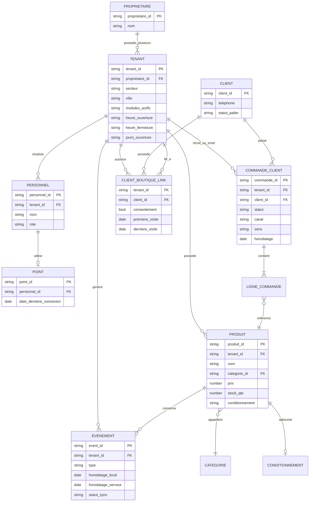

**Note pour l'implémentation** : ce diagramme est fonctionnel, pas un schéma physique définitif — `EVENEMENT` peut se traduire par plusieurs tables techniques selon le type d'événement, mais la relation logique `TENANT → EVENEMENT` et son immuabilité doivent être préservées quel que soit le découpage physique choisi.

---

## 11. Machines à états — récapitulatif

| Entité | États | Section |
|---|---|---|
| Commande (client → boutique, ou boutique → fournisseur) | Nouvelle → Vue → Confirmée / Annulée | §6.4, généralisée en §6.7 |
| Produit hors catalogue | Inconnu → Ajouté au panier → Vendu → Proposé au stock → Créé / Ignoré | §3.4 |
| Palier client | Anonyme → Reconnu → Installée / Identifié | §7.1 |
| Événement (sync) | Créé localement → En attente → Synchronisé | §5.1 |

---

## 12. Modules complémentaires et activation par tenant

Chaque module (CRM, Facturation, Comptabilité, RH, Marketing, Paiement mobile, E-commerce, Automatisation, Commandes fournisseurs, Groupe multi-boutique) est **activable indépendamment**, via une table `TenantModulesActifs`. Le module **Commandes fournisseurs** ne demande aucun nouveau moteur : il active simplement le sens `sortant` du domaine §6. Le module **Groupe multi-boutique** (§9) n'est pertinent que pour un `Propriétaire` ayant plus d'une `Boutique`. Un module non activé :
- n'apparaît dans aucun écran de gestion pour ce tenant ;
- ne reçoit aucun événement (un backend modulaire ne doit pas router d'événements vers un module désactivé, même silencieusement) ;
- reste disponible pour activation à tout moment sans migration de données bloquante — les événements passés restent lisibles rétroactivement dès l'activation.

---

## 13. Règles transversales non négociables

Ces règles s'appliquent à **tout** développement dans ce projet, quel que soit le domaine :

1. **Une vente ou un mouvement de stock ne peut jamais être bloqué** par une donnée de gestion manquante (catégorie, fiche produit) — la gestion se répare après coup, jamais avant.
2. **Tout événement métier est immuable et identifié par UUID** — une correction est un nouvel événement, jamais une modification en place.
3. **Aucune requête ne doit pouvoir traverser deux tenants**, ni pour les données de gestion (§10), ni pour le comportement client (§7.4) — cette isolation doit être structurelle (au niveau de la requête/API), pas seulement filtrée côté UI. **Exception explicitement encadrée** : un même propriétaire ayant plusieurs boutiques peut consulter une vue consolidée entre ses propres boutiques (§9) — ce n'est pas une violation de cette règle, c'est un périmètre d'agrégation différent, jamais étendu à des tenants d'un autre propriétaire.
4. **Le mode hors ligne n'est pas un cas d'erreur** — c'est un mode de fonctionnement normal et attendu à concevoir dès le départ, pas à ajouter après coup.
5. **Le consentement est toujours explicite, jamais pré-coché, et toujours réversible** par périmètre (par boutique, pas globalement).

---

## 14. Notes pour l'équipe IA dev (agents de développement assisté par IA)

- **Ne pas inventer de champs ou d'entités** au-delà de celles nommées dans ce document (§10) sans les faire valider — la cohérence terminologique (§1) est ce qui permet à plusieurs agents/développeurs de converger sur le même modèle.
- **Toute fonctionnalité qui écrit une donnée métier doit d'abord produire un événement** (§5.1) avant toute projection ou vue dérivée — ne jamais implémenter un raccourci qui écrit directement une "table d'état" sans passer par le journal d'événements, même pour aller vite en prototypage.
- **Respecter les machines à états (§11) au pied de la lettre** : une transition non listée dans un diagramme de ce document est probablement un bug, pas une fonctionnalité manquante à improviser — remonter la question plutôt que de créer un nouvel état.
- **Tester systématiquement le cas hors ligne et le cas multi-tenant** pour toute nouvelle fonctionnalité, pas seulement le chemin heureux connecté — ce sont les deux dimensions qui distinguent DAVEX d'un CRUD classique.
- **Un agent qui implémente un domaine (§3 à §8) doit relire les sections "Dépendances"** de ce domaine avant de coder une intégration — c'est là que sont listés les contrats avec les autres domaines.

---

## 15. Traçabilité vers les autres documents

| Besoin | Document |
|---|---|
| Vision produit et présentation du projet | `DAVEX_Architecture_Fonctionnelle.md` |
| Choix d'infrastructure, stack technique, sécurité détaillée | `DAVEX_Architecture_Technique.md` |
| Écrans, flows utilisateur, design system | `DAVEX_UIUX_MVP_v2.md` |
| Démonstration cliquable des flows décrits ici | `DAVEX_Prototype_Interactif.html` |
