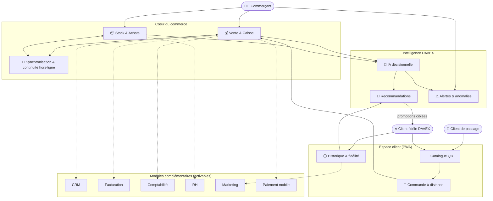
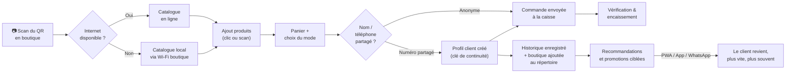

# DAVEX Business Suite™ — Architecture fonctionnelle
### Document de présentation du projet

---

## 1. Vision en une phrase

DAVEX n'est pas un logiciel de gestion : c'est un **compagnon de commerce**. Le commerçant l'ouvre pour vendre ; la gestion, le stock, la fidélisation et l'intelligence se produisent en arrière-plan, presque invisiblement.

---

## 2. Les acteurs du système

| Acteur | Qui il est | Ce qu'il attend de DAVEX |
|---|---|---|
| **Commerçant** | Gérant d'un commerce de proximité | Vendre vite, ne jamais perdre de temps en saisie, comprendre son activité en un coup d'œil |
| **Client de passage** | Scanne un QR Code, pas de compte | Un catalogue instantané, commander sans installer d'application |
| **Client fidèle DAVEX** | A partagé son numéro, PWA installée | Retrouver ses boutiques, son historique, des offres pertinentes |
| **Plateforme DAVEX** | Le système lui-même | Apprendre de chaque commerce sans jamais mélanger leurs données entre eux |

---

## 3. Vue d'ensemble — architecture fonctionnelle

**Lecture du schéma** : le commerçant ne touche jamais qu'au cœur du commerce (Vente, Stock, Synchronisation). Le client — de passage ou fidèle — n'entre en contact qu'avec son propre espace (Catalogue, Commande, Historique). L'intelligence DAVEX observe les deux côtés mais ne mélange jamais les données d'un commerçant avec celles d'un autre. Les modules complémentaires s'activent à la carte, sans jamais devenir obligatoires.

---

## 4. Les grands blocs fonctionnels

### 🏪 Cœur du commerce (usage quotidien du commerçant)
- **Vente & Caisse** — encaisser, y compris un produit qui n'est pas encore en stock.
- **Stock & Achats** — suivre les quantités, réceptionner par photo de facture, ajouter un produit manuellement avec son conditionnement (unité, carton, paquet).
- **Synchronisation & continuité hors-ligne** — les ventes continuent sans Internet, entre appareils d'un même commerce comme avec le cloud dès que la connexion revient.

### 📱 Espace client (sans installation obligatoire)
- **Catalogue QR** — accessible en ligne ou en local via le Wi-Fi de la boutique si Internet est absent.
- **Commande à distance** — le client compose son panier lui-même (Scan & Achat ou Précommande), la caisse la reçoit instantanément.
- **Historique & fidélité** — mémoire progressive du client, du simple navigateur anonyme jusqu'au profil synchronisé sur plusieurs boutiques.

### 🤖 Intelligence DAVEX
- **IA décisionnelle** — anticipe les ruptures, détecte les marges en baisse, signale les anomalies.
- **Recommandations** — personnalise l'offre de chaque boutique à partir de ce que le client a acheté *chez elle*, jamais chez une autre.
- **Alertes** — remontées au commerçant sur l'écran Accueil, jamais imposées en interruption.

### 🧩 Modules complémentaires (activables à la carte, par secteur et par commerce)
CRM, Facturation, Comptabilité simplifiée, RH, Marketing, Paiement mobile — chacun partage le même entrepôt de données du commerce, pour une vision unique de l'activité.

---

## 5. Parcours fonctionnel de bout en bout — du client de passage au client fidèle

**Ce que ce parcours démontre** : chaque étape reste utile même si le client s'arrête avant la fin. Un client anonyme obtient déjà l'essentiel (commander sans faire la queue) ; le partage du numéro n'est jamais une condition, seulement une option qui enrichit l'expérience — cohérent avec le principe fondateur : ne jamais demander plus que le strict nécessaire.

---

## 6. Ce qui distingue DAVEX

| DAVEX | Logiciel de gestion classique |
|---|---|
| S'ouvre sur "Vendre" | S'ouvre sur un tableau de bord |
| Devine l'information avant de la demander | Demande une saisie systématique |
| Fonctionne sans Internet, y compris entre appareils du commerce | Nécessite une connexion permanente |
| Un client peut commander sans jamais installer d'app | Impose souvent un compte ou une app dédiée |
| Chaque commerçant garde la maîtrise de sa relation client, même sur une plateforme partagée | Les données clients sont souvent centralisées sans cloisonnement clair |
| La fidélisation naît de la simplicité et du temps gagné | La fidélisation repose sur des cartes ou des points |

---

## 7. Modules — vue synthétique d'activation

| Module | Statut au MVP | Dépend de |
|---|---|---|
| Vente | Fondation | — |
| Stock / Achats | Fondation | — |
| Synchronisation locale & cloud | Fondation | — |
| Catalogue QR / Commande client | MVP | Vente |
| Fidélisation client | MVP (extension) | Catalogue QR, CRM |
| Assistant IA | MVP | Vente, Stock |
| CRM | Activable | Catalogue QR / Fidélisation |
| Facturation | Activable | Vente |
| Comptabilité simplifiée | Activable | Vente, Stock |
| Paiement mobile | Activable, isolable tôt | Vente |
| RH | Activable | — |
| Marketing | Futur | Fidélisation |
| E-commerce complet | Futur | Catalogue QR |
| Automatisation | Futur | Tous modules |

---

*Ce document est une vue fonctionnelle destinée à la présentation du projet. Le détail technique (modèle de données, protocole de synchronisation, sécurité) est couvert dans `DAVEX_Architecture_Technique.md`. Le détail des écrans et interactions est couvert dans `DAVEX_UIUX_MVP_v2.md`.*
