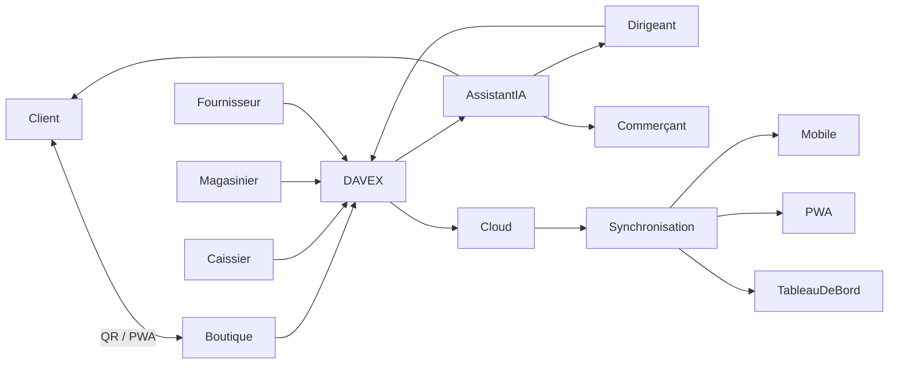
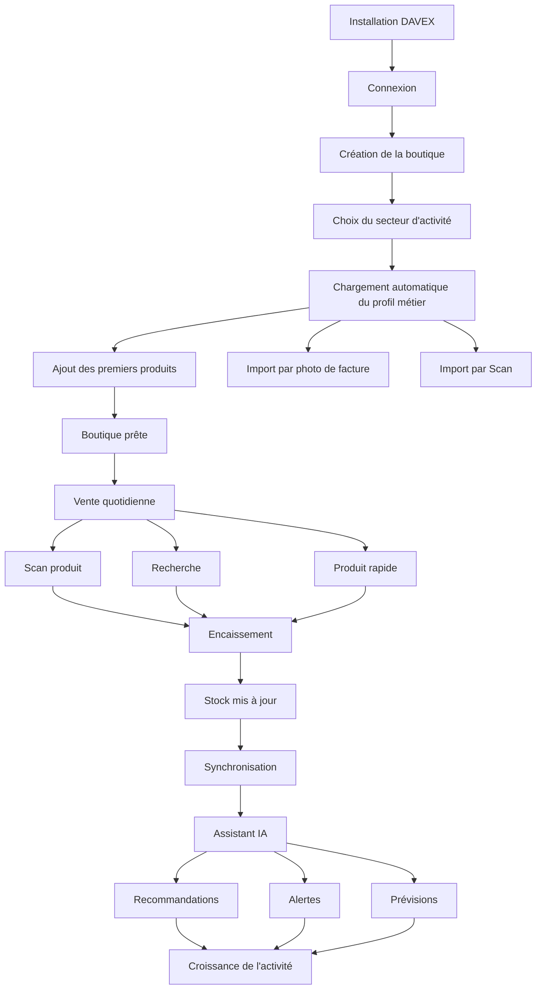
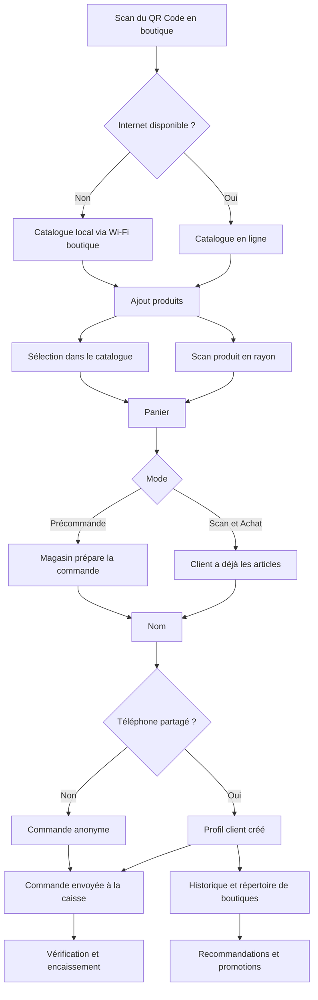
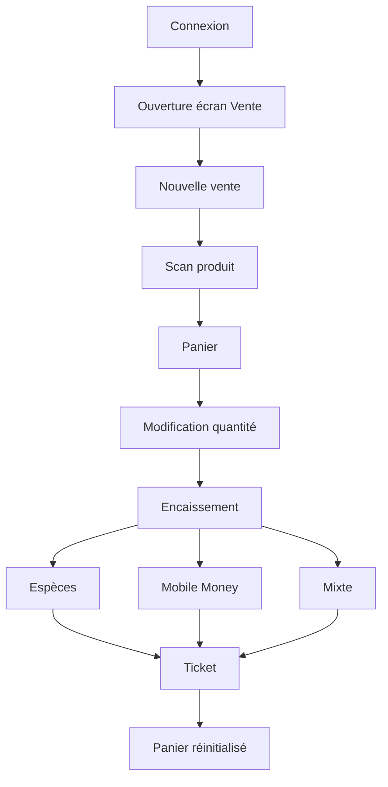
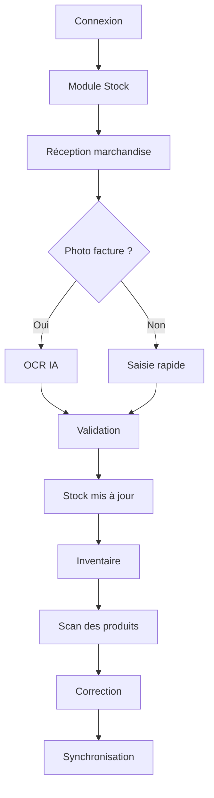
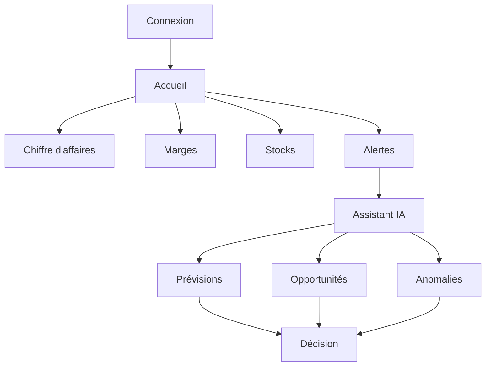
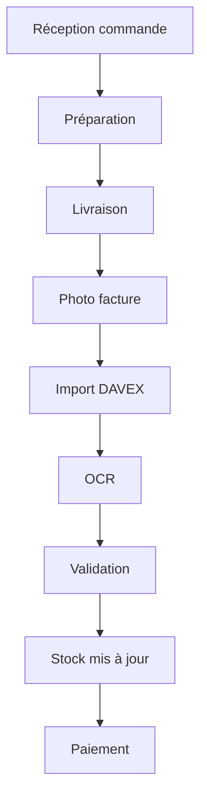
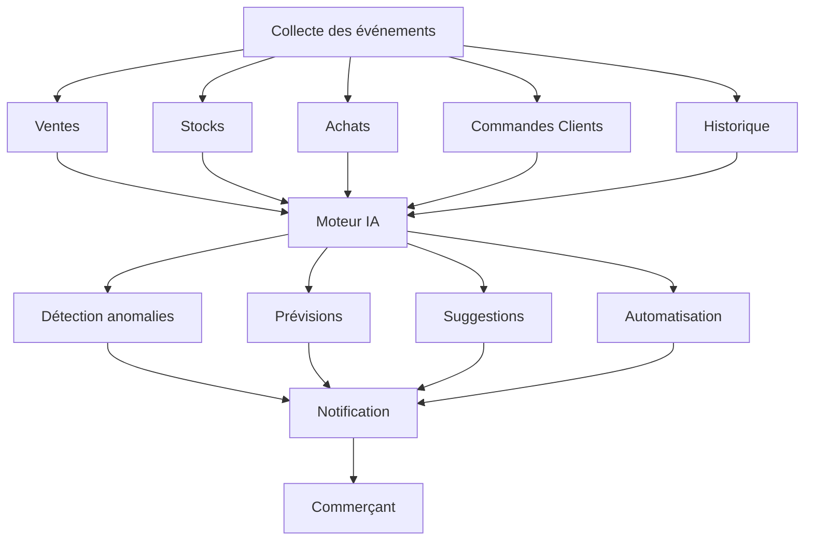

# [title:Vision Produit]# DAVEX Business Suite™
# Vision Produit

> **Version 1.0**
>
> *"Le système d'exploitation du commerce africain."*

---

# 1. Notre conviction

La majorité des commerces et PME africains ne manquent pas de logiciels.

Ils manquent d'outils qui comprennent réellement leur manière de travailler.

Les logiciels actuels ont été conçus pour gérer une entreprise.

DAVEX est conçu pour aider une entreprise à travailler.

Nous croyons qu'un commerçant ne devrait jamais interrompre une vente pour remplir un formulaire, rechercher un menu ou mettre à jour un stock.

La technologie doit disparaître derrière le métier.

Le commerçant vend.

DAVEX s'occupe du reste.

---

# 2. Notre mission

Simplifier radicalement la gestion des commerces et PME africains grâce à une plateforme intelligente, mobile et accessible, qui automatise les tâches répétitives afin que chaque entrepreneur puisse consacrer son temps à développer son activité.

---

# 3. Notre vision

Construire le système d'exploitation de référence des commerces africains.

DAVEX n'est ni un simple logiciel de caisse, ni un ERP traditionnel.

C'est une plateforme qui connecte le commerçant, ses employés, ses clients, ses fournisseurs et l'intelligence artificielle dans un même écosystème.

Notre ambition est qu'un jour, ouvrir une boutique commence simplement par :

> **« Installe DAVEX. »**

---

# 4. Les principes fondateurs

## Le commerçant travaille.
DAVEX gère.

La gestion ne doit jamais devenir une tâche supplémentaire.

Elle est la conséquence naturelle de l'activité.

---

## Une information est saisie une seule fois...
...ou jamais.

DAVEX privilégie :

- le scan,
- la photo,
- la voix,
- les suggestions intelligentes,

avant toute saisie manuelle.

---

## Le mobile est la plateforme principale.

L'application est pensée d'abord pour Android.

Le PC représente un confort supplémentaire, jamais une obligation.

---

## L'IA assiste.

L'humain décide.

DAVEX recommande, anticipe et automatise, mais les décisions importantes restent toujours sous le contrôle du commerçant.

---

## La simplicité est une fonctionnalité.

Chaque écran, chaque bouton et chaque processus doivent faire gagner du temps.

Une fonctionnalité qui complique le travail n'a pas sa place dans DAVEX.

---

# 5. Les piliers de DAVEX

- Mobile First
- Offline First
- AI Native
- Zero Data Entry
- Sector Native
- Modular Platform
- Cloud Sync
- Privacy by Design
- Progressive Adoption
- Customer Centric

Ces piliers guident toutes les décisions de conception, d'architecture et d'évolution du produit.

---

# 6. Une plateforme pour tout l'écosystème

DAVEX accompagne chaque acteur du commerce.

### Le commerçant

Vendre rapidement, gérer simplement et développer son activité.

### Les employés

Disposer d'outils adaptés à leur rôle sans complexité inutile.

### Le dirigeant

Comprendre son entreprise grâce à des indicateurs clairs et des recommandations intelligentes.

### Le client

Découvrir les produits, commander facilement, retrouver ses achats et bénéficier d'une expérience personnalisée.

### Les fournisseurs

Faciliter les réapprovisionnements et améliorer les échanges commerciaux.

---

# 7. Une adoption progressive

DAVEX ne demande jamais à un utilisateur plus d'engagement qu'il n'a déjà obtenu de valeur.

## Vision globale de l'écosystème DAVEX

Ce diagramme résume la philosophie de la plateforme : DAVEX est le cœur de l'écosystème, reliant tous les acteurs (client, commerçant, employés, fournisseurs et IA) autour d'un même flux d'informations, tout en gardant une expérience simple pour chacun.

### Parcours commerçant

### Parcours Client
La confiance précède toujours l'installation.

### Parcours caissier

### Parcours magasinier

### Parcours Dirigeants

### Parcours fournisseur

### Parcours assistant IA

---

# 8. Notre ambition

Nous voulons démocratiser les outils numériques pour des millions de commerces africains.

DAVEX doit être :

- simple pour une boutique de quartier ;
- suffisamment puissant pour une PME ;
- suffisamment évolutif pour accompagner la croissance d'une entreprise.

Chaque nouveau commerce rejoint un réseau qui s'améliore.

Chaque nouveau client enrichit son expérience.

Chaque innovation doit rendre le commerce plus simple, plus rapide et plus intelligent.

---

# Notre promesse

**DAVEX transforme la gestion en une conséquence naturelle du travail quotidien.**

Le commerçant vend.

Le client achète.

L'intelligence artificielle assiste.

La plateforme apprend.

Et l'entreprise grandit.
